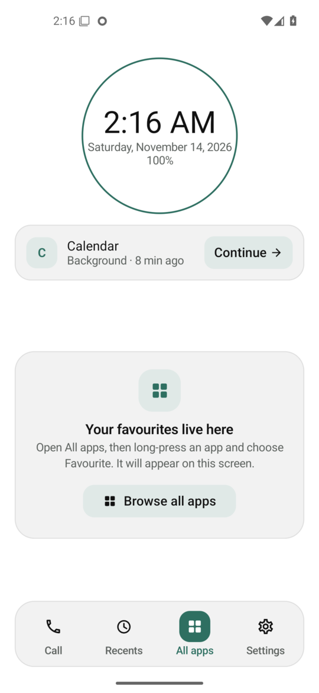
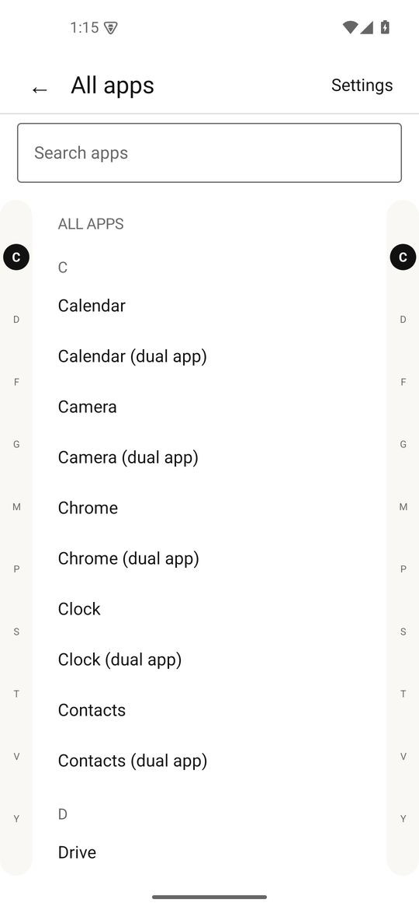
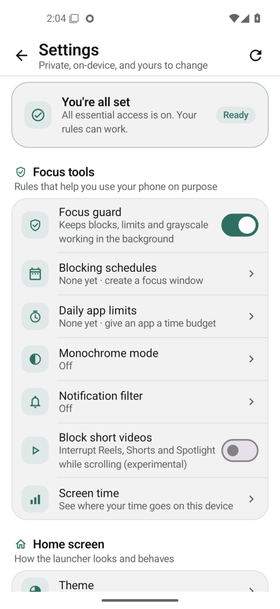

# Still Launcher

[](https://github.com/yash244466666/still-launcher/actions/workflows/ci.yml)
[](https://github.com/yash244466666/still-launcher/releases)
[](LICENSE)

A text-first Android launcher for digital wellbeing, built as an independent open-source project.

Still Launcher replaces the home-screen icon grid with a short list of names, then adds optional focus tools: timed app blocks, day/time schedules, daily app budgets, per-app grayscale, notification filtering, and screen-time statistics. There is no account, no advertising, and no analytics SDK.

> **Status:** 0.3.0. Built, unit-tested (20/20) and smoke-tested on an Android 15 (API 35) emulator. Not yet tested on physical devices. See [Limitations](#limitations).

---

## Install on a phone

Download the **signed release APK** from the [latest stable release](https://github.com/yash244466666/still-launcher/releases/latest), not an arbitrary mirror. Release APKs are minified, signed and published with `SHA256SUMS`.

### Play Protect says the app may be unsafe

Still Launcher is self-distributed from GitHub, not Google Play. Android's Play Protect shows an “unknown developer” warning for sideloaded apps and is especially cautious about apps that use accessibility. This is a heuristic, not a malware report.

1. Tap **More details → Install anyway**.
2. If your phone offers no install option, install from a computer with `adb install -r still-launcher-<version>-release.apk`.
3. Verify the download before installing:

   ```bash
   sha256sum -c SHA256SUMS
   apksigner verify --print-certs still-launcher-<version>-release.apk
   ```

Official release certificate SHA-256:

```
af841912594162f29ea85a12b2bb8347c016a938fb31ccfa0fdc4e3812c35def
```

Do not permanently disable Play Protect for apps you do not trust.

### Accessibility or notification access is greyed out

Android 13+ blocks these permissions for apps installed outside an app store until you allow restricted settings:

1. Open **Settings → Apps → Still Launcher** (Xiaomi/HyperOS: **Apps → Manage apps → Still Launcher**; Samsung: **Apps → Still Launcher**).
2. Tap the **⋮** menu on the app-info page and choose **Allow restricted settings**. If the option is missing, first try to enable the service or notification access; Android refuses once and then exposes the menu item. Return to app info and try again.
3. Return to **Accessibility** and enable **Still Launcher focus guard**. For notifications, use **Settings → Notifications → Device & app notifications**, or **Special app access → Notification access**.
4. Usage access lives under **Settings → Apps → Special app access → Usage access** and does not use restricted settings.

The same guidance, with direct buttons to the relevant settings, is built into the app under **Settings → Install & access help**.

### F-Droid test repository

A self-hosted F-Droid repository is available while official F-Droid inclusion is prepared:

- URL: `https://yash244466666.github.io/still-launcher/repo/`
- Fingerprint: `8C:16:3E:E1:19:37:A6:58:F9:65:07:57:0F:E0:23:98:3A:EC:32:16:26:6D:88:05:F7:C3:3C:82:D3:0F:A1:7D`

Install [F-Droid](https://f-droid.org/F-Droid.apk), open **Settings → Repositories → Add repository**, paste the URL and fingerprint, then search for **Still Launcher**. This avoids the Play Protect install block and gives F-Droid-managed updates. It does **not** bypass Android's restricted-settings protection for accessibility; that step remains.

---

## Why this exists

Most phones are designed to keep you on them. Still Launcher takes the opposite approach: a quiet list of names, a clock, and a small set of tools you switch on deliberately.

This is an independent clean-room project. **No source code, assets, strings, icons, or branding from any commercial launcher are used here.** All code, text and artwork are original, and the project is not affiliated with or endorsed by any other launcher.

---

## Features

| Area | What works |
|---|---|
| Home screen | Clock + date circle with battery arc, a labelled icon dock, background-app card with one-tap return, Recents shortcut, favourites with letter badges and a guided empty state |
| App list | Letter-badge rows with a clear search field, a long-press hint and a two-sided drag/tap alphabetic index with a live current-section highlight; dual/cloned apps from all Android profiles, a Recent apps section, favourites, folders, hide/rename/move/unhide, app info, uninstall |
| App blocking | Block any app for 1 h – 30 days; full-screen block screen with countdown and an explicit “end block early” escape |
| Schedules | Recurring day/time windows that block a chosen set of apps; overnight windows supported |
| Daily limits | Per-app daily budget; choose remind / exit / 15-minute cooldown behaviour; live usage display |
| Monochrome | Per-app grayscale via Android’s display daltonizer; opt-in, requires a one-time adb grant |
| Notification filter | Allow-list of apps that may post; disallowed notifications are cancelled and listed in-app |
| Short-video guard | Optional accessibility probe that interrupts YouTube Shorts, Instagram Reels and Snapchat Spotlight while scrolling (experimental; app updates can change the probes) |
| Screen time | Today / week / month per-app usage reconstructed from UsageStats events |
| Appearance | System / black / white / E-Ink / custom background, four font families, nine text sizes, date/time formats |
| Gestures | Swipe up for search, swipe down for notification shade, double-tap to lock |

## Screenshots

| Home | App list | Settings |
|---|---|---|
|  |  |  |

---

## Releases

- **Tagged releases** (`v*`) are built, signed, checksummed and published by [`.github/workflows/release.yml`](.github/workflows/release.yml).
- **Every push to `main`** refreshes a rolling prerelease called [Latest build](https://github.com/yash244466666/still-launcher/releases/tag/latest) with a signed, non-debuggable release APK and SHA-256 sums.
- Pull requests and `main` run tests, lint and a debug build in [`.github/workflows/ci.yml`](.github/workflows/ci.yml).

To cut a release:

```bash
git tag v0.3.0
git push origin v0.3.0
```

Or run the **Release** workflow manually with a version number.

### Release signing

The release and latest-build workflows expect four repository secrets: `SIGNING_KEYSTORE_BASE64`, `SIGNING_KEYSTORE_PASSWORD`, `SIGNING_KEY_ALIAS`, `SIGNING_KEY_PASSWORD`. Generate a keystore once and keep a secure backup; Android will not install an update signed by a different key. Forks must configure the same secrets or the latest-build workflow fails by design instead of publishing a debug APK.

```bash
keytool -genkeypair -v -keystore release.jks -alias stilllauncher \
  -keyalg RSA -keysize 4096 -validity 10000
base64 -w0 release.jks | gh secret set SIGNING_KEYSTORE_BASE64
```

---

## How it is built

```
app/src/main/java/org/stilllauncher/
├── MainActivity.kt              single-activity Compose host + HOME intent
├── StillViewModel.kt            settings/app-list state and all mutations
├── data/
│   ├── Models.kt                BlockedApp, BlockSchedule, AppLimit, AppFolder, Settings
│   ├── SettingsStore.kt         Preferences DataStore, JSON for collections
│   ├── AppRepository.kt         LauncherApps / PackageManager
│   └── UsageRepository.kt       UsageStatsManager event-interval reconstruction
├── service/
│   ├── MonitorEngine.kt         foreground -> block / limit / grayscale decisions
│   ├── MonitorService.kt        specialUse foreground service, 2 s UsageStats poll
│   ├── AppAccessibilityService.kt  instant foreground events + global actions
│   ├── NotificationFilterService.kt  NotificationListenerService allow-list
│   └── BootReceiver.kt          restart the guard after reboot
└── ui/                          Compose screens (home, apps, settings, focus tools)
```

Enforcement is deliberately transparent and user-owned:

1. **Accessibility service** reports `TYPE_WINDOW_STATE_CHANGED` / `TYPE_WINDOW_CONTENT_CHANGED`.
2. **MonitorService** polls `UsageStatsManager` every two seconds as a fallback.
3. Both call `MonitorEngine.onForeground(packageName)`.
4. The engine checks, in order: timed block → active schedule → daily limit → cooldown.
5. A match launches `BlockedActivity` or `ReminderActivity` with the reason and end time.
6. Monochrome is applied on the same transition by writing `accessibility_display_daltonizer*`, and is cleared on screen-off.

Nothing is enforced with device-owner or kiosk APIs; force-stopping the app or revoking a permission turns enforcement off. That is intentional: this is a wellbeing tool, not a lock.

---

## Permissions

| Permission | Why | Required? |
|---|---|---|
| `PACKAGE_USAGE_STATS` | foreground detection + screen-time stats | recommended |
| Accessibility service | immediate foreground detection, double-tap lock | optional |
| Notification listener | notification allow-list | optional |
| `POST_NOTIFICATIONS` | foreground-service notification | recommended |
| `SYSTEM_ALERT_WINDOW` | lets the block/reminder screen appear over the app on Android's background-activity rules | recommended |
| `WRITE_SECURE_SETTINGS` | per-app grayscale only | optional, adb only |
| `RECEIVE_BOOT_COMPLETED` | restore the guard after reboot | optional |

`QUERY_ALL_PACKAGES` is **not** used. App visibility comes from a `<queries>` MAIN/LAUNCHER intent, which is the least-privilege way to build a launcher. Battery optimisation is opened through the system list; the app does not declare `REQUEST_IGNORE_BATTERY_OPTIMIZATIONS`.

On Android 13+, accessibility and notification access may require **Allow restricted settings** in the app-info menu. See [Install on a phone](#install-on-a-phone) or the built-in **Settings → Install & access help**.

### Grayscale grant

```bash
adb shell pm grant org.stilllauncher android.permission.WRITE_SECURE_SETTINGS
```

---

## Build

Requirements: JDK 17, Android SDK platform 36, build-tools 36.

```bash
./gradlew :app:assembleDebug
# APK: app/build/outputs/apk/debug/app-debug.apk
```

Set `sdk.dir` in `local.properties` or `ANDROID_HOME`.

---

## Privacy

- No `INTERNET` permission is declared. The app cannot phone home.
- Blocks, limits, folders, notification settings and statistics stay in Preferences DataStore inside the app sandbox.
- Filtered-notification history is kept in memory only and cleared when the process dies.
- Accessibility content is read only to determine the foreground package. Screen text is not stored or transmitted.

---

## Verification (2026-11-13)

Smoke-tested on the `yash_tools_api35_test` Android 15 emulator:

- onboarding → home; clock, date, battery arc and favourites
- background-app indicator after leaving an app, with one-tap return and the Recents shortcut
- all-apps list, search field, letter sections, alphabetic index bar, Recent apps section, long-press actions, favourites
- timed block: Chrome blocked, `BlockedActivity` shown with countdown and end-early escape
- schedule editor with day/time/app pickers (overnight 22:00–07:00)
- daily-limit editor and saved limit
- monochrome: `accessibility_display_daltonizer_enabled` toggles 1→0 and value 0→-1 when entering/leaving the selected app
- notification filter: a shell notification was cancelled and recorded as `com.android.shell`
- swipe up (app list) and swipe down (notification shade)
- install & access help screen; the release APK is non-debuggable, APK Signature Scheme v3, and its runtime certificate fingerprint matches the published value
- the app-menu index bar is available on both edges, highlights the current section while scrolling, animates taps and shows a spring letter bubble while scrubbing
- dual-profile apps are listed separately and launched with the correct user handle (verified with a managed-profile Calendar clone; the launcher must be the default home app for Android to expose other profiles)
- permission status updates automatically every 2 seconds while the Permissions screen is open, on return from system settings, and on Refresh; usage, accessibility, notification and overlay state are re-read each time
- black theme, including white system-bar icons; Home intent resets navigation to the launcher screen

Not exercised at runtime: the reminder activity, schedule enforcement at the exact wall-clock window, short-video probes (need real YouTube/Instagram/Snapchat UIs).

## Limitations

- Tested on an emulator; not yet exercised on a physical device in this workspace.
- Android does not expose a global “currently running apps” list. The home indicator shows the most recent app that came to the foreground; it is a resume shortcut, not a live process monitor.
- Play Protect warnings and Android 13+ restricted settings are OS behaviours that cannot be removed by the app. The release APK is non-debuggable and signed, and the in-app help explains the exact bypass paths. Distribution through Google Play or F-Droid is the only way to remove the unknown-developer warning entirely.
- The **Recents** shortcut uses the accessibility service's global action. Without that service it shows a hint instead.
- Android exposes another profile's launchable apps only to the current/default launcher. If dual apps are missing, set Still Launcher as the default home app. Full secondary users (not profiles) are not visible to normal apps.
- Pinned to AGP 8.13 and compileSdk 36. The 2026 AndroidX line requires AGP 9.1 and compileSdk 37; that migration is deliberately separate from the 0.1.x line.
- Grayscale depends on OEM support for the daltonizer secure setting.
- Some OEMs aggressively kill foreground services; battery-optimisation exemption is recommended.
- Notification filtering may not catch notifications posted while the listener is disconnected.
- No multi-user/work-profile UI yet; launcher apps are loaded for the current user.
- The block screen can be dismissed by ending the block. This is a deliberate wellbeing choice, not a bug.

---

## Documentation

- [Architecture](docs/ARCHITECTURE.md) — layers, persistence, enforcement, notification filtering
- [Changelog](CHANGELOG.md)
- [Contributing](CONTRIBUTING.md)
- [Security policy](SECURITY.md)
- [Code of Conduct](CODE_OF_CONDUCT.md)

### For AI agents

- [CLAUDE.md](CLAUDE.md) — Claude Code handbook: invariants, architecture, recipes, verification, release rules
- [AGENT.md](AGENT.md) — tool-agnostic agent handbook and full task recipes
- [GEMINI.md](GEMINI.md) — Gemini CLI entry point
- [AGENTS.md](AGENTS.md) — pointer for agents that look for the plural filename
- [.claude/](.claude/) — committed Claude Code settings, `/verify` and `/release` commands, and an Android reviewer subagent

All agents must keep the project offline, original and free of AI/assistant commit attribution.

## License

GNU General Public License v3.0. See [LICENSE](LICENSE).

This project is not affiliated with, endorsed by, or derived from any commercial launcher. “Still Launcher” and its icon are original.
